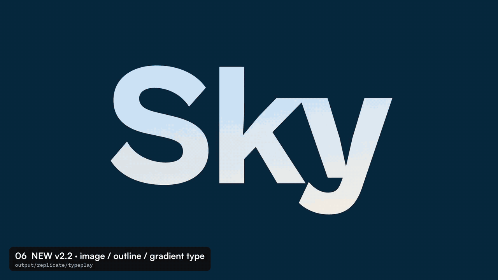
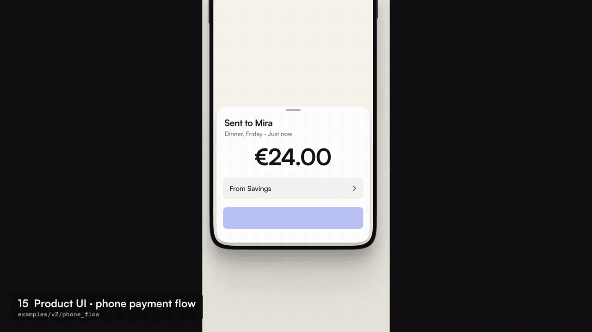
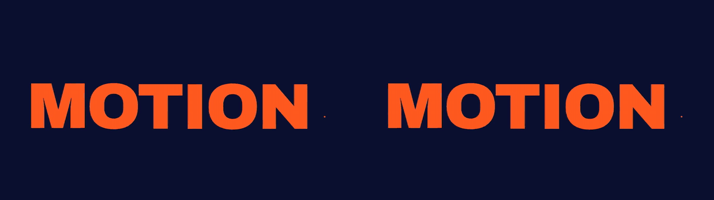
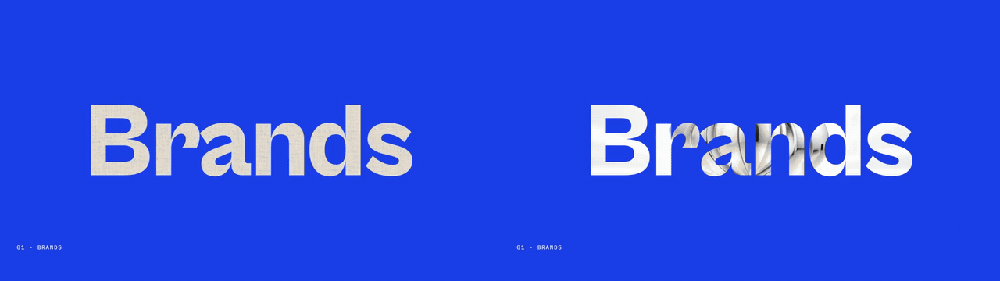

# MotionEngine

MotionEngine is a Rust engine that turns a short brief, or a small JSON program, into a finished
motion-graphics video. It plans the piece on the beat grid of a music track, lays out kinetic type,
charts, diagrams, product-UI flows, sketches and photo collages, checks the result against a ledger
of known design mistakes, repairs what it can, and renders an MP4 with music and sound. Compiling and
rendering are deterministic: the same inputs and seeds give the same scene and the same frames.

It is built for agent harnesses. A model writes a brief or a `CreativeIntent` and gets back a video
path, a QA verdict and a critique score in one short JSON line, at a cost of a few hundred tokens per
video.

## Gallery

| | |
|---|---|
| [](showcase/capability_highlights_720p.mp4) | [](showcase/type_styles_720p.mp4) |
| **Capability highlights**: type, charts, product UI, sketch, layering, lockups ([MP4](showcase/capability_highlights_720p.mp4)) | **Type styles**: gradient, image and outline fills, case control, doodles drawn with the type ([MP4](showcase/type_styles_720p.mp4)) |
| [](showcase/capability_highlights_720p.mp4) | [](showcase/capability_highlights_720p.mp4) |
| **Charts and diagrams**: line, area and bar charts, rail and card diagrams | **Product UI**: typed payment, promo and sign-up flows on device frames |

[](showcase/layering_before_after_720p.mp4)

**Layering**: the same program before (left) and after (right) intentional layering (`over`) and
plate-less sketches ([MP4](showcase/layering_before_after_720p.mp4)).

[](showcase/generated_assets_720p.mp4)

**Generated assets**: a bundled texture (left) against a generated image plate used as a type fill
(right) ([MP4](showcase/generated_assets_720p.mp4)).

Narrated v1 reels (voice-over with word-synced captions) are in [showcase/](showcase/README.md).

## Features

- **Components**: backdrop, shape, title, kinetic text, chart, field, HUD, diagram, code block,
  device frame, lockup, sketch, bento and photo stack. A program is a closed
  vocabulary of components and verbs, validated before anything is drawn.
- **Layering**: a sketch, shape, photo stack, backdrop or field can be drawn `over` a named component
  on purpose; accidental overlaps are still rejected.
- **Type styles**: solid, gradient or image fills (text masks), outlines, case control, measured
  fitting, poster cuts, glyph drops and type-on.
- **Sketch**: natural-media strokes in the style of p5.brush (hatching, flow fields, watercolour,
  golden spirals, architectural hatch), with or without a framed plate.
- **Product UI**: device frames with typed flows (payment, sign-up, upload, share, settings toggle),
  real app states, cursor and tap targets.
- **Charts**: line, area, bar and donut charts that draw on the beat, spring curves, count-up
  callouts, thousands separators.
- **Diagrams**: rail, card and outline diagrams that build one node per beat.
- **Bento** metric grids, **lockups** (five presets for closing titles) and **photo stacks** (nine
  layouts over a bundled cutout library).
- **Transitions**: whip, colour flip and impact; a program camera with push, pan, frame, orbit, dolly, roll and focus moves.
- **Music and beat sync**: bundled tracks with offline beat analysis; every start and end snaps to a
  frame on the beat grid, and the final hit lands on a downbeat. Sound effects and a mix to −16 LUFS.
- **QA mistake ledger**: every known design defect is a detector with a fixture. Programs are checked
  statically and on rendered frames, auto-repaired up to twice, and refused if a gate still fails.
- **MCP server**: `motion-mcp` exposes the engine to any MCP client; brief to video in three calls.
- **Generated assets**: programs can declare image plates and cutouts (`gen:<id>`). They are made
  once through an asset provider (OpenArt over MCP, or an optional local MOSS-Image server), cached
  and pinned in a lockfile, so later compiles are offline and byte-identical.
- **v1 narrated reels**: `CreativeIntent` → voiced explainer with karaoke captions, picture library,
  art direction, speech QA, and an auto-edit mode for talking-head video.

## Requirements

- Rust, stable toolchain, edition 2021 (tested with 1.92).
- FFmpeg and ffprobe on `PATH`, with libx264 and AAC.
- Optional: `cmake` for local word timing (`--features asr-local,asr-ctc`).
- Optional: an [OpenRouter](https://openrouter.ai) API key for the free narration voice in v1 reels.
  `--tts-model say` uses the offline macOS voice instead.
- Optional: a GPU (Metal, Vulkan or DX12) for `render --gpu` post effects (build with `--features gpu`);
  the CPU renderer is the reference.

macOS and Linux are supported. Everything in the default build and test run works offline.

## Install

```bash
git clone https://github.com/abhishekaryan23/motion-engine.git
cd motion-engine
cargo build --release -p motion-cli          # the motion-engine binary
cargo build --release -p motion-mcp          # the MCP server (optional)
```

Fonts (under their own open licences, `assets/fonts/licenses/`) and music beds are bundled in `assets/`; nothing
else needs to be installed. Some optional faces are fetched with `scripts/fetch_fonts.sh` (`assets/fonts/RESTRICTED.md`);
without them the engine uses open fallbacks.

## Quick start

From a brief:

```bash
./target/release/motion-engine make --brief "Cold brew orders grew from 12k in January to 31k in July. Most cups are bought before 9am."
```

One JSON line comes back with the MP4 path (under `output/make/<name>/`), the program, a per-beat
contact sheet, `qa` (`pass` or the failing ledger ids) and a critique score out of 40. Direction words
in the brief ("a 15 s vertical", "go all out") set length, aspect and recipe and never appear on
screen; quoted text, numbers and statements are content.

From a program (QA, auto-repair, then render):

```bash
./target/release/motion-engine program render examples/v2/coffee_story.program.json
```

Check a program without rendering, or run every offline command at once:

```bash
./target/release/motion-engine program qa examples/v2/flow_board.program.json
scripts/cli_smoke.sh
```

## A minimal MotionProgram

```json
{
  "version": "2.0",
  "meta": { "name": "flow_board", "aspect": "16:9", "duration": 5.0, "end_beat": 8 },
  "palette": { "background": "#0B0C10", "ink": "#F2EFE8", "accent": "#FF4A1C", "muted": "#8C93A3" },
  "music": { "track": "driving_pulse", "start": 0.107 },
  "tempo": "fast",
  "components": [
    { "id": "g", "kind": "backdrop" },
    { "id": "flow", "kind": "diagram", "preset": "cards",
      "nodes": ["Brief", "Script", "Voice", "Edit", "Publish"], "start_beat": 0, "beat_cuts": 2 },
    { "id": "cap", "kind": "kinetic_text", "preset": "type_on", "slot": "bottom", "colour": "muted",
      "start_beat": 1, "beat_cuts": 2,
      "words": ["why it exists", "lines that land", "said out loud", "cut on the beat"] }
  ]
}
```

Components are placed in slots and timed in beats; the engine decides sizes, easing, colours (from
palette roles) and layout. The schema is `schema/motion_program.json`; more samples are in
`examples/v2/`.

## MCP

```bash
cargo build --release -p motion-mcp
./target/release/motion-mcp --profile v2
```

The `v2` profile has four tools: `make_video` (brief or `CreativeIntent` → MP4, QA and critique),
`edit_video`, `preview` (one small frame or the beat sheet) and `critique`. A typical session is
`make_video` → `critique` → `preview`. The `weak`, `creator` and `operator` profiles serve v1 narrated
reels with fewer or more tools depending on the model. To register the server with an MCP client,
copy `docs/mcp/claude-code.mcp.json` to `.mcp.json` and set the binary path. Details:
[docs/MCP.md](docs/MCP.md).

## Project layout

| Crate | Role |
|---|---|
| `crates/motion-core` | Intent and style schemas, the v1 compiler, the `MotionScene` format, timeline evaluation, easing and springs, audio planning, critique. No pixels, no network. |
| `crates/motion-render` | The `Renderer` trait and CPU backend (tiny-skia), text shaping and outlines (cosmic-text), textures, the asset cache, optional GPU post effects, PNG and FFmpeg export. |
| `crates/motion-program` | `MotionProgram`: schema, validation, deterministic lowering, components, palette roles and design passes, camera, layout, QA and the mistake ledger with repairs. |
| `crates/motion-bridge` | Brief or intent → program: named recipes, the bar planner on the beat grid, claim headlines, typed UI flows. |
| `crates/motion-providers` | Asset providers: an MCP client with OAuth, the OpenArt adapter, the local MOSS-Image provider, spend policy, cache, lockfiles. |
| `crates/motion-voice` | Text to speech, voice cache, optional local speech recognition for word timing. |
| `crates/motion-mcp` | The MCP server. |
| `crates/motion-cli` | The `motion-engine` binary. |

Bundled data: `assets/` (fonts, picture and loop library, music beds, recipes, the mistake ledger and
its fixtures), `examples/` (programs, intents and styles), `golden/` (regression scenes and frames),
`schema/` (public JSON schemas), `benchmarks/` (reference-interpreter benchmark).

## Documentation

- [ARCHITECTURE.md](ARCHITECTURE.md): data flow, crate boundaries, determinism rules
- [docs/DESIGN_RULES.md](docs/DESIGN_RULES.md): the taste gates, colour roles, UI kit and sound rules
- [docs/PROVIDERS.md](docs/PROVIDERS.md): asset providers, spend policy, cache and lockfiles
- [docs/MCP.md](docs/MCP.md) and [docs/mcp/](docs/mcp/): the MCP server and its guides
- [docs/PUBLIC_INTERFACE.md](docs/PUBLIC_INTERFACE.md): the stable interface for AI consumers
- [docs/AI_AUTHORING_GUIDE.md](docs/AI_AUTHORING_GUIDE.md), [docs/CLI_CONSUMER_GUIDE.md](docs/CLI_CONSUMER_GUIDE.md): writing briefs and intents, using the CLI
- [docs/MOTION_QA.md](docs/MOTION_QA.md), [docs/TESTING.md](docs/TESTING.md): QA and tests
- Subsystems: [VOICE](docs/VOICE.md), [SOUND_DESIGN](docs/SOUND_DESIGN.md), [TYPOGRAPHY](docs/TYPOGRAPHY.md),
  [ART_DIRECTION](docs/ART_DIRECTION.md), [GENRE_GRAMMARS](docs/GENRE_GRAMMARS.md),
  [MOTION_OPS_2](docs/MOTION_OPS_2.md), [POST_EFFECTS](docs/POST_EFFECTS.md),
  [ASSET_PIPELINE](docs/ASSET_PIPELINE.md), [architecture diagrams](docs/architecture/README.md)
- [CHANGELOG.md](CHANGELOG.md), [SECURITY.md](SECURITY.md)

## Contributing

See [CONTRIBUTING.md](CONTRIBUTING.md) for the development setup, the test gate, determinism rules
and how to add a component or a mistake-ledger entry.

## License

MotionEngine is released under the **MotionEngine Limited License**: you may clone, build and run it
for personal evaluation, research and non-commercial testing. Commercial use, hosting it as a
service and redistribution need a separate written license. Read [LICENSE](LICENSE) for the terms.
The bundled fonts keep their own open licenses (`assets/fonts/licenses/`), and the music beds carry
the terms in `assets/music/`.
