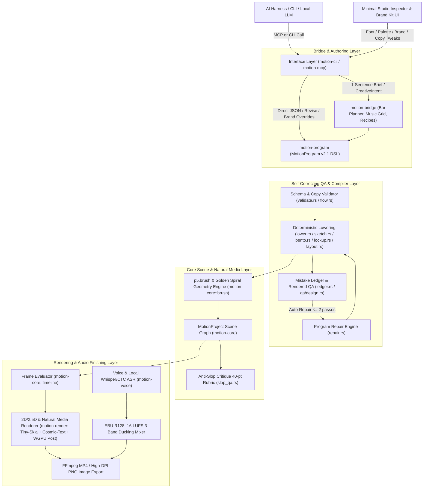
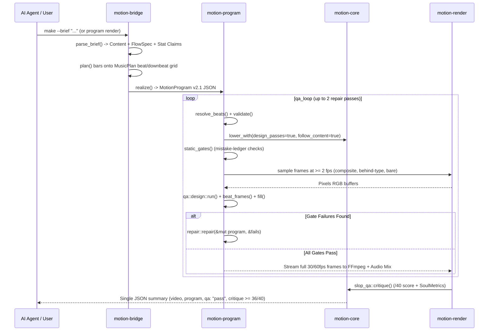

# MotionEngine v2.1 — Visual Architecture (HLD & LLD)

MotionEngine is an AI-native, deterministic Rust engine unifying **Video Editing, Image/Poster Editing, 2D Vector Motion Graphics, `p5.brush` Natural Media & Watercolor, Golden Ratio ($\varphi = 1.618$) Layouts, 2.5D Tactile Composition, and Native Product UI Flows**.

---

## 1. High-Level Design (HLD)

---

## 2. Low-Level Design (LLD) — `qa_loop` & Lowering Pipeline

---

## 3. Strict Layering & Dependency Graph

Dependencies flow strictly top-down with zero circular imports:

1. **Interface Layer (`motion-cli`, `motion-mcp`)** → orchestrates CLI commands (`serve`, `make`, `program`), stdio MCP tools, and the `qa_loop`.
2. **Bridge Layer (`motion-bridge`)** → translates natural-language briefs and v1 `CreativeIntent` into beat-locked `MotionProgram` v2 specifications.
3. **Program Compiler & QA Layer (`motion-program`)** → owns the v2.1 component vocabulary (`kinetic_text`, `sketch`, `bento`, `photo_stack`, `chart`, `diagram`, `shape`, `field`, `lockup`, `code_block`, `device_frame`), Golden Ratio ($\varphi = 1.618034$) modular scale (`taste.rs`), OKLCH color resolver (`palette.rs`), layout passes (`layout.rs`), continuous camera (`camera.rs`), Mistake Ledger (`ledger.rs`), and deterministic `repair.rs`.
4. **Voice & Provider Subsystem Layer (`motion-voice`, `motion-providers`)** → isolated domain crates for TTS/ASR word timing and external asset generation with strict spend caps.
5. **Rendering Layer (`motion-render`)** → stateless frame rasterizer (`CpuRenderer` via `tiny-skia`, `p5.brush` ribbon & opacity-bucketed stamp batching, wet watercolor bleed layers, `cosmic-text` glyph outlines, optional `wgpu` post-processing, Apple Vision `matte`, and FFmpeg streaming).
6. **Foundation Layer (`motion-core`)** → pure data contracts (`MotionProject`, `Scene`, `Layer`, `MotionOp`, `CameraOp`), `p5.brush` natural media & multi-chamber Golden Spiral geometry (`brush.rs`), spring/bezier math, frame evaluation (`evaluate_frame`), audio planning, and `slop_qa` critique. Contains zero pixel rendering or I/O network logic.
